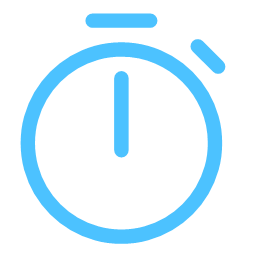

<p align="center">
  
</p>

<h1 align="center">Focus Timer</h1>

<p align="center">A simple Pomodoro timer and stopwatch for Windows.</p>

## Features

### Timer
* Focus and break sessions that switch automatically when one ends
* Set your own focus and break lengths in minutes and seconds (25/5 by default)
* Start, reset, or skip to the next session
* Keeps track of how many sessions you've finished and your total focus time

### Stopwatch
* Shows hours, minutes, seconds and hundredths
* Record laps with both the lap time and the running total

### Settings
* Close to tray so the timer keeps going after you close the window
* Optionally only close to tray while the timer is running
* Get a notification when a focus session or break ends
* Shortcut to the Windows Do Not Disturb settings

## Download

Grab the latest build from the [Releases](https://github.com/trbatukim/Focus-Timer/releases) page. 

Right click the Instal script and select "Run with Powershell" to install.

## Building from source

You'll need:
* Windows 10 version 1809 or newer
* Visual Studio 2022 with the **WinUI application development** workload
* .NET 8 SDK

Then:
1. Clone the repo
   ```
   git clone https://github.com/trbatukim/Focus-Timer.git
   ```
2. Open `Focus-Timer.slnx` in Visual Studio
3. Pick your platform (x64, x86 or ARM64) and hit run

## Built with

* [WinUI 3 / Windows App SDK](https://github.com/microsoft/WindowsAppSDK)
* [Windows Community Toolkit](https://github.com/CommunityToolkit/Windows) for the settings cards
* [WinUIEx](https://github.com/dotMorten/WinUIEx) for the tray icon and window helpers

## License

[LICENSE.txt](LICENSE.txt).
